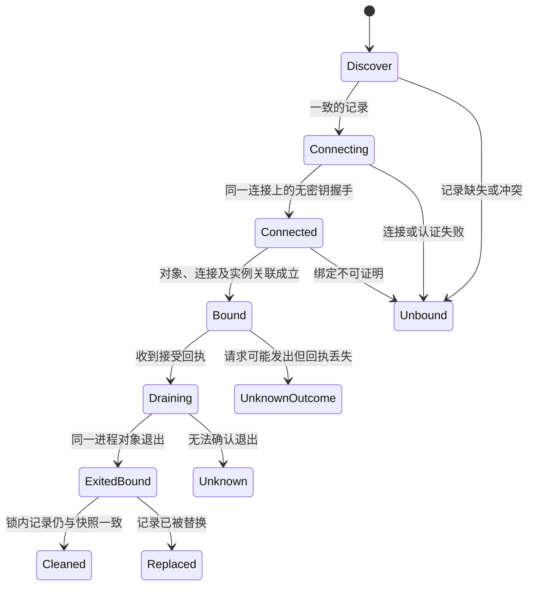

# Daemon 身份协议 v1：可实施的评审方案

**状态：用户已接受安全默认值；协议细节待评审，尚未实现。** 2026-11-12 用户明确接受：新客户端默认拒绝未绑定停止，新 daemon 默认关闭 HTTP `/shutdown`，并知悉对旧客户端和远程运维的影响。未绑定兼容操作只能显式发起，不自动强杀。其余线路、格式和平台能力仍是待实现、待验证的设计，不能说成已有保证。对应 [CNB #22](https://cnb.cool/zdzso/agent2ssh/-/issues/22)，以 `587ebee` 为代码和 #25 实测基线。本文收敛旧草案 [daemon-identity-protocol.md](daemon-identity-protocol.md) 的 D1–D6；与旧草案的建议冲突时，以本文为本轮评审文本。实现和平台验收分别属于 #20、#21、#23、#24、#25；不把当前 TCP + PID 检查描述为本协议。

## 1. 推荐决定及对 #25 的直接答案

| 项 | v1 推荐 | 代价与必须审阅的兼容性 |
|---|---|---|
| D1 威胁范围 | 防止正常崩溃、重启、PID 复用、非恶意继承、端点切换和不同用户访问；同 uid 能主动替换程序、窃取 token、伪造配置或有调试权限者不在认证保证内。 | socket 权限和 token 无法抵御同 uid 主动攻击；代理/继承不能因为 D1 排除而忽略。 |
| D2 兼容 | **新客户端默认不向 `Unbound` 的端点发送停止请求**。旧 daemon 仅由显式单次 `--allow-unbound-graceful`（桌面等价明确操作）允许尝试一次 HTTP 优雅停止；必须提示可能停错、管理员 token 可能交给错误端点，且永不自动发信号；已观察到 PID/实例/端点矛盾或代理时即使给出该选项也必须拒绝。新 daemon 默认拒绝 HTTP `/shutdown`，只有显式管理员兼容开关才开放，包括空 body；远程 HTTP 停止同受影响。 | 会改变旧客户端和远程运维行为。旧客户端和旧 daemon 的组合不能被新程序保护；历史回滚或显式兼容开关重新暴露旧风险。安全默认值已获用户确认；目前代码尚未实施。 |
| D3 强制终止 | 仅 `Bound` 且始终用同一个已持有内核进程对象等待、发信号；进程不可观察、权限失败或连接身份不符均不强杀。 | macOS v1 不提供自动强杀；Windows 独立重连在可证明方案验收前也不提供。诊断和带外处理是必需品。 |
| D4 本机通道 | Unix domain stream socket / Windows local-only named pipe **新增专用停止协议**。现有 HTTP 用于其他 API，不能作为绑定的回退；HTTP `/shutdown` 只在 D2 显式兼容开关下保留。 | 协议与旧客户端不兼容、需各平台测试。禁止运行两条自动停止协议及从 IPC 自动退回 TCP；对远程用途显式标识为非本地停止，不对本机 PID 发信号。 |
| D5 命名及权限 | 一个配置目录、一个持锁发布的专用本机端点。Unix socket 放在经校验、只允许拥有者访问的本地配置目录；Windows 命名管道名称由持久随机配置标识派生，明确 DACL、首实例与拒绝远程；路径太长或无法保护时拒绝，不截断、不改用共享路径。 | 配置复制、相对路径、软链接及不同用户可能无法使用；须报具体原因。标识不作为秘密或认证证据。 |
| D6 记录 | 保留数字 `daemon.pid`，新增版本化 `daemon.instance.json`；明确锁内发布、两文件不原子、条件清理和降级。精确的生成号不从 PID/时钟推断。 | 旧程序不参与锁或忽略新记录时不能保证安全迁移；新旧共存需要显式策略，不允许自动认领。 |

**#25 的实现边界已明确**：macOS 新独立客户端取得对端线索并完成无密钥握手后仍为 `Unbound`，本版不可按 PID 自动强杀。`LOCAL_PEERPID` / `LOCAL_PEERCRED`、`kqueue`、微秒起始时间可用于发现矛盾和诊断，不能单独升级成 `Bound`；新客户端默认拒绝未绑定停止。用户若明确选择 D2 的单次兼容尝试，可发一次不绑定的旧 HTTP 优雅停止并承担停错风险，不能声称绑定、不能自动补发或 `kill`。#25 可以据此实现保守拒绝、诊断、明确的单次兼容交互和平台验证，而不需要等待 Linux 的 pidfd 原型。用户已确认上述安全默认值；具体发布、旧版迁移和远程运维方案仍需实现评审与验收，不能宣称现有代码已应用。

## 2. 保护对象、可信假设与术语

一次本地停止要同时保护：①只能请求用户选择的**实例**结束；②强制终止只能作用于原本绑定的进程对象；③进程退出后不能删除新实例的记录；④未知状态不能报成成功。`daemon.pid`、文件锁、路径、实例 ID、`/health`、token、回执、进程名、启动时间分别只有发现、协调、鉴权或交叉检查用途；均不是单独证明。

`Bound` 不是 PID 数值相等，而是**本次调用拥有平台进程对象 O，且可信地建立了连接 C 的控制端与 O 的关联**。需同时满足：对象由内核安全取得、不会随数字 PID 复用指向新进程；连接和对象属于同一实例；协议实现保证监听 fd、已连接 fd 或管道句柄不会被 fork/exec、子进程继承、`SCM_RIGHTS`、中介或代理用于代答；所有校验从同一连接完成。最后一项是**待实现、可审计的部署不变量**，不是内核凭据自动证明的事实。若无法建立或验证不变量，包括检测到继承/代理或实现路径未覆盖，就不能宣称 `Bound`。这一限制决定了 Linux peer pidfd 仍须通过 #23 的原型和跨进程测试；它不是“获取一个 fd 就自动达标”。

上面保证不覆盖同 uid 有意修改客户端/daemon、窃取 token、替换端点并同时伪造握手；若未来 D1 改为防此类对手，须另立信任根、重新做威胁模型，不能补一个随机 ID 就声称解决。不同 uid、远程及越权客户端依赖操作系统权限、ACL、token 与实际部署；须逐平台实测，失败关闭。

## 3. 状态机与操作结果

状态绑定在一次调用持有的 C/O、记录快照 R 和 deadline 上，不能序列化后在另一个客户端继续使用；任何重连必须重来。`Unknown`、`Unbound` 不是 `Exited` 的别名。



图仅显示主要路径；具体拒绝、期限和清理失败以表格为准。

| 状态 | 触发和动作 | 允许的转换 |
|---|---|---|
| `Discover` | 锁内读取并保存原始 `daemon.pid` 与完整版本化 R；损坏、缺失、不一致、未知版本、权限或锁超时均保留证据 | 一致才进入 `Connecting`；否则 `Unbound`/`Unknown` |
| `Connecting` | 锁外打开 R 指定的本机端点 C，限制连接/握手/响应和总 deadline；发送不含 token 的 `hello` | 未连接、错误身份或实例不一致 → `Unbound`；成功仅为 `Connected` |
| `Connected` | 在 **C 上**取得平台对端信息与无密钥的 `hello_ok` 并与 R 对照；取得 O，并检查第 2 节的对象和连接关联、不变量；此阶段不得发送管理员 token | 全部证明且 O 未退出 → `Bound`；不足、失效、代理、句柄继承或观察失败 → `Unbound`；禁止 `pidfd_open(peer_pid)` 或 `OpenProcess(peer_pid)` 单独晋升 |
| `Bound` | 先在原 C 上发送管理员 token 并取得授权，再向该实例发一条优雅停止；O 一直持有；不重连、不切换实例 | 明确接受 → `Draining`；明确拒绝 → `Refused`；请求可能发出但回执丢失/超时 → `UnknownOutcome` |
| `Draining` | 等 O 退出；超过期限仅在 O 仍为绑定对象、权限和策略允许时对 O 强制终止 | O 可证明退出 → `ExitedBound`；不可观察/期限结束 → `Unknown`；不得改用裸 PID |
| `ExitedBound` | 不持网络锁；持文件锁重读两个记录，完整匹配 R 才按 §5 清理 | `Cleaned`、`Replaced` 或 `CleanupFailed`，分别报告；记录已替换不是清理成功 |
| `Unbound` / `Refused` / `Unknown` / `UnknownOutcome` | 保留记录，提供不含 token 的诊断；默认无自动停止、强杀、删除或新实例覆盖 | 用户检查后重新发现；`UnknownOutcome` 不自动重试，单次兼容路径须单独明确同意 |

`Accepted` 表示响应声称接受，不等于退出；如果 C 在发请求后断开，即使之后能找到相同 PID/端点也不能推断是否成功。`ExitedBound` 必须来源于 **O 的退出**；`kill(pid, 0)==ESRCH` 只说明观测时该号码不存在，不能证明历史实例身份，也不能独自触发 `ExitedBound`。未经绑定的管理员显式清除残留属于 #21 独立恢复操作，只能清理记录、不能发信号；需要锁内比对原始内容，确认的只是用户接受不确定性，旧程序不配合时仍无完全安全保证。

## 4. 线协议及对象建立

### 4.1 一个连接、一个停止操作

采用本地私有的长度前缀 UTF-8 JSON 流：4 字节无符号大端长度 + JSON，单帧最大 **16 KiB**，先检查长度、UTF-8、完整对象和版本，再执行；截断、超限、重复 key、未知字段/版本均拒绝，不能部分执行。首次仅允许一组不含秘密的 `hello`/`hello_ok`；客户端验证同连接的 peer 与进程对象、进入 `Bound` 后，才发送 `authorize`/`authorized`，随后至多一条 `stop` 与一条结果；不支持复用、自动重连、代理或隐式重试。认证成功不替代进程绑定。帧、连接和总期限分别受界，且绝不在文件锁内等待。具体消息用例（值为示意）：

```json
{"type":"hello","version":1,"client_nonce":"128-bit-random-hex"}
{"type":"hello_ok","version":1,"client_nonce":"<echo>","instance_id":"<128-bit-random-hex>","pid":1234}
{"type":"authorize","version":1,"admin_token":"<secret>"}
{"type":"authorized","version":1,"result":"ok"}
{"type":"stop","version":1,"instance_id":"<same>","expect_pid":1234,"request_id":"<128-bit-random-hex>"}
{"type":"stop_result","version":1,"instance_id":"<same>","request_id":"<same>","result":"accepted","checked_pid":1234}
```

实例 ID、nonce 和 request ID 是关联、去重和证否工具，不是鉴权根；管理员 token 只用于 daemon 授权客户端，不能证明服务端是目标进程。客户端必须在同一 C 上先完成服务端绑定且 O 仍可观察，再发送 token；若验证失败、身份矛盾或连接断开，关闭连接，不发送 token。消息均在 **同一条本机 C** 上收发；daemon 完整鉴权、检查 `instance_id`/`expect_pid == 自己 PID` 后才能触发 drain，错误请求不得有副作用。`request_id` 只在当前连接内防重；断线/重启后不承诺去重，也不允许据此自动重放。不得记录 token、原始帧或包含 token 的诊断；对端 UID/SID 是客户端认证的独立检查，不替代 token 或反向的服务端身份。这里的消息是拟定新协议，不是现有 HTTP `/shutdown` 的已实现字段；#20 的回执需同步设计。

### 4.2 平台条件及拒绝边界

**Linux / #23，候选路径（未实机验收）**：daemon 自己在私有目录创建、bind、listen；在同一连接 C 上，客户端优先使用 `getsockopt(SO_PEERPIDFD)` **直接**取 peer pidfd O，而非先读数字 PID 再 `pidfd_open`；再核对 peer 凭据、R、握手及不变量，O 全程不关闭、不替换。使用 `poll` 等等待 O，以 `pidfd_send_signal(O, ...)` 强杀；不借 `/proc/<pid>` 再打开对象作为替代。实现必须检查调用返回和权限、PID namespace、异常退出/已回收、`ENOPROTOOPT`/`ENODATA` 等；不支持则 `Unbound`。Linux 6.5 源码在 `SO_PEERPIDFD` 中从 socket 保存的 peer pid 生成 pidfd，而 Unix listener 的凭据在 `listen` 初始化并在连接时复制：O 因此与**内核记录的 peer 凭据**关联，不自动证明谁实际持有或写入连接。实现须禁止并测试 listener/accepted fd 的继承、传递与代理，未证明时保持 `Unbound`。内核版本号不是能力证明，以运行时测试为准。

**Windows / #24，当前默认 `Unbound`**：`GetNamedPipeServerProcessId(C)` 得到数字 PID，并不关闭之后 `OpenProcess(pid)` 前的复用窗口；不能以管道 ACL、PID、随机 ID 或重复读取时间自行填平。父进程保留 `CreateProcess` 返回的真实进程句柄只是 O 的一部分，还需把 C 与 O 证明关联，并处理句柄继承/多实例/服务退出时序；没有经 Windows 真机验证的证明前仍 `Unbound`，含独立重连。原型可研究启动时预建不可委派管道与句柄，但不预先宣布成功。管道 DACL 不得给客户端 `FILE_CREATE_PIPE_INSTANCE`；使用首实例和拒绝远程的机制，核对自身 SID、拒绝未授权用户并实测，不能把 pipe 名称或 SID 当作进程身份。拒绝访问是未知，不是已退出。

**macOS / #25，当前默认 `Unbound`**：客户端在 C 上读 `LOCAL_PEERPID` 可用于对照 R，但 #25 已用真实父子 socket 实测已连接 fd 交给仍存活子进程写入后返回子进程 PID。`NOTE_EXIT | NOTE_EXITSTATUS` 对本机 pid 1 的 `EACCES` 是瞬时权限线索；单标志和双标志不同，均不提供通过同一对象发信号。`proc_pidinfo` 微秒字段也不封闭 PID→`kill` 窗口。实现读取这些线索仅用于诊断/拒绝，不得调用裸 PID `kill` 作为自动强杀或将它们升级为 `Bound`；不把未研究的其他原语宣称为永不可能。

**直接启动者**：可保留操作系统创建时返回的进程对象，但即使 O 已固定，独立建立的 C 仍需证明与 O 相连；仅比较 PID 不足。启动时预建且严格禁止继承/委派的专用端点或其他候选必须在各平台原型中证明该联系。启动者退出后其内存句柄不能从 PID 文件恢复；独立重连只能按各平台规则重新发现，不能继承上次 `Bound`。

## 5. 记录、发布与恢复

`daemon.pid` 保持现有纯十进制正 PID，供旧版读取；`daemon.instance.json` 示例：

```json
{"version":1,"instance_id":"<128-bit-random-hex>","pid":1234,"config_id":"<persistent-random-hex>","endpoint":{"kind":"unix","path":"daemon-control.sock"},"boot_hint":"<optional-diagnostic>","start_hint":{"value":123456789,"unit":"us","precision":"microsecond"}}
```

版本、id、PID、端点类型/相对路径格式严格校验；`config_id` 用独立持久文件生成并以同目录原子方式发布，复制配置会复制它，因此它只用于命名/发现而不是机器身份。Unix path 必须是相对于经验证的配置目录的固定文件名；Windows record 保存逻辑 pipe 名而非可重定向 URL。可选 `boot_hint`/`start_hint` 只诊断，不参与授权或对象等价；未知单位或精度、旧秒级 `daemon.owner` 直接标记 legacy，不把 `sec * 1_000_000` 当作实际微秒值或与之精确匹配。记录不含 token；不得跟随记录文件或目标路径的软链接/非普通文件，平台无法保证时拒绝。

推荐发布顺序：在同一 `.daemon-pid.lock` 下重读两份文件与 config_id，拒绝存在且无法安全判定的记录；检查安全目录、建立并监听端点（仅本地、不能等连接），在同一文件系统预写临时记录并同步内容；先原子替换 `daemon.pid`，再替换 `daemon.instance.json`，尽力同步目录，全部完成后才宣告 ready；监听 socket 在发布期间可能已接受内核排队连接，但 daemon 不得处理握手、读取 token 或执行停止，发布失败时关闭端点并拒绝排队连接。两次 rename **不是事务**，不承诺掉电原子；任一步失败，关闭自身端点，保留可诊断残留，不自删不属于自己的记录。执行期不得因 `kill(pid,0)==ESRCH` 自动替换缺损/旧版记录。临时文件采用独占创建、权限设置、同目录替换；目录 fsync/Windows 替换及断电语义需在各平台验收，不能把“尽力同步”当成持久保证。Unix 域名 socket pathname 残留不能无条件 unlink，无法证明不是活端点就拒绝启动并指向恢复。

崩溃/升级表（记录均需锁内重读；**不**用 HTTP 的自报来修复）：

| 磁盘状态 | 新客户端 / 新 daemon 动作 |
|---|---|
| 两文件齐全且实例字段一致 | `Discover`；仍须连接和绑定，不能据此停止 |
| 只有旧数字 PID、只有实例文件、空/坏 JSON、未知版本、两文件 PID 不一致 | 保留并显示 `Unbound`；不自动删除/覆盖/发信号。可经 #21 的显式记录恢复流程检查 |
| 两文件均无但端点存在或连接状态未知 | 保留端点，拒绝自行 unlink/重绑；人工检查 |
| 绑定 O 已退出，锁内 R 与 PID 均字节/语义匹配原快照 | 条件清理己方记录；PID 文件只在其内容仍匹配时删除，实例文件按 instance ID 及完整快照复核。分步删除中崩溃即回到不一致、保留诊断 |
| 锁不可用、目录权限不安全、文件不是普通文件、记录被替换 | 拒绝；`Replaced`/`Unknown`，不删除新内容 |
| 旧程序忽略锁、同名文件被外部替换、NFS/不可靠锁或 rename 语义 | v1 的配合进程保证失效；拒绝宣称安全，停止使用自动操作并要求人工恢复 |

旧客户端遇新 daemon 可能只看 `daemon.pid`，无法解释实例文件或新端点，也可能执行旧的清理：升级前须停止或隔离旧版并迁移活动实例；不能以版本检测保证不存在旧进程。回滚到旧版会重新允许未绑定强杀、忽略实例文件并留下 socket/JSON；先带外停止新 daemon、备份并核查残留，再按回滚说明显式清理，不能声称旧版受到新保护。

## 6. 兼容和异常矩阵

| 情况 | v1 新客户端动作 | 已有旧客户端/daemon |
|---|---|---|
| 新/新，平台满足 §4 的绑定前提 | 单连接 Bound 停止和对象等待；满足条件才对同一对象强杀 | 旧客户端默认无法经新 daemon HTTP 停止；显式 legacy 开关有风险 |
| 新/旧、IPC 不存在或协议未知 | 默认拒绝；若无已知身份矛盾，显式单次兼容可发一次旧 HTTP 优雅停止，标 `Unbound`，警示 token 可能暴露给错误端点，不强杀、不自动重试 | 旧/旧保持原有行为及风险 |
| 新/新，macOS 或 Windows 当前未证明绑定 | 默认拒绝；兼容选项属于不绑定的明确例外；可报告服务端回执，但不能仅凭该回执声称目标进程已退出或已绑定 | #25/#24 实现诊断及提示；新 daemon 若默认关 HTTP，则该例外需管理员先开启兼容开关或带外处理 |
| `expect_pid`/实例/peer 矛盾、端点抢占、代理 | 拒绝，不发送停止；保留记录 | 旧端无法保证 |
| 回执缺失、损坏、错实例、认证失败 | 不认作成功；发出前拒绝，发出后为 `UnknownOutcome`，不自动重放 | 不用错误 200 反推“旧版本” |
| O 退出、复用 PID、新实例出现 | 只凭 O 证明旧实例退出；重读记录，已替换则不清理；不得向新 PID 发信号 | 旧版绕过协议不受约束 |
| 权限不足、观察失败、锁超时、内核不支持、名字过长 | `Unbound` / `Unknown`，保留记录，显示精确恢复理由 | 不静默降级 |
| 请求已写出但响应丢失 / 连接切换 | `UnknownOutcome`；不重新连接代发或自动补发；是否手动重新发现由用户决定 | 无法宣称未执行 |
| 回滚、老进程或不受信锁/文件系统 | 停用自动动作，走显式人工恢复；若还在运行旧客户端，标明新保证不适用 | 兼容路径带回历史风险 |

## 7. 交付与验收顺序

1. **#22 评审**：用户已确认 D2 的两项安全默认值及其旧版/远程影响；其余实现细节、威胁模型和平台能力须在编码前评审。记录 macOS 默认没有自动停止/强杀的体验与显式兼容路径，不能把提案说成已实现。
2. **#20 / #21**：定义旧 HTTP 回执和人可理解的 `Unbound`、`UnknownOutcome`、权限拒绝、记录损坏、端点冲突、条件清理反馈。不得借“用户确认”把身份不明变成 `Bound`；明确 token/日志脱敏与恢复的竞态边界。
3. **#23 Linux**：构造真实 Unix socket 与 `SO_PEERPIDFD` 原型，验证 peer 凭据采样时机、监听 fd 和已连接 fd 的继承/传递、父进程退出、client PID namespace、内核不支持和权限失败；在可控注入下重现“peer PID 已取、原进程退出、同 PID 被复用，再打开对象”，证明裸 `pidfd_open` 不可升级；测试 peer pidfd 的 wait/signal 指向同一对象并覆盖 A/B 切换。当前主机是 macOS，未实测 Linux。
4. **#24 Windows**：真实机器测首实例、DACL/远程拒绝、管道多实例、进程句柄及管道 server PID 采样、继承与代理、`OpenProcess` 前复用/拒绝访问；证明不了即保持 `Unbound`。不能以其他平台结果替代。
5. **#25 macOS**：基于已实测 peer PID/传递结果实现不绑定默认拒绝、不自动信号、可操作诊断和显式兼容流程；用真实进程覆盖 A/B、伪造、权限不足、旧 daemon、端点和 PID 记录并发替换、目标退出与不可观察、跨版本和不可靠目录。无法稳定构造 PID 复用时结合可控注入，明确未实测，不能只断言状态码。
6. **全平台契约**：每一个非法转换都测试（不可 `Unbound → force`、`Unknown → cleanup`、断线后向 B 重试）；真实进程前后分别核对 A/B 是否存活和原/新记录内容，隔离 `AGENT2SSH_CONFIG_DIR`。矩阵覆盖新旧客户端 × 新旧 daemon、兼容开关启用前后、HTTP 空 body 和远程停止、权限失败、记录发布前后各崩溃点、锁被替换及回滚。同步 `api.yaml`、配置指南与 K14，只有平台原型和真实验收通过才能声称对应保证已落地。

## 8. 原语依据与证据等级

- Linux 6.5 官方源码 [`SO_PEERPIDFD` 的 `sock_getsockopt`](https://raw.githubusercontent.com/torvalds/linux/v6.5/net/core/sock.c) 与 [Unix listener/连接凭据](https://raw.githubusercontent.com/torvalds/linux/v6.5/net/unix/af_unix.c)：**读源码推导**，不是本机实测，也不保证实际响应者未继承 socket。
- Microsoft [进程句柄与 PID](https://learn.microsoft.com/en-us/windows/win32/procthread/process-handles-and-identifiers)、[命名管道安全与权限](https://learn.microsoft.com/en-us/windows/win32/ipc/named-pipe-security-and-access-rights)、[首管道实例与远程拒绝](https://learn.microsoft.com/en-us/windows/win32/api/namedpipeapi/nf-namedpipeapi-createnamedpipew)：**官方能力描述**，不是 Windows 实机结果。
- [macOS 后续实测及源码](../reports/macos-daemon-identity-followup-2026-11-12.md)：**本机实测**，只覆盖文中列出的 OS、权限和进程构造；不能外推所有进程和平台。
